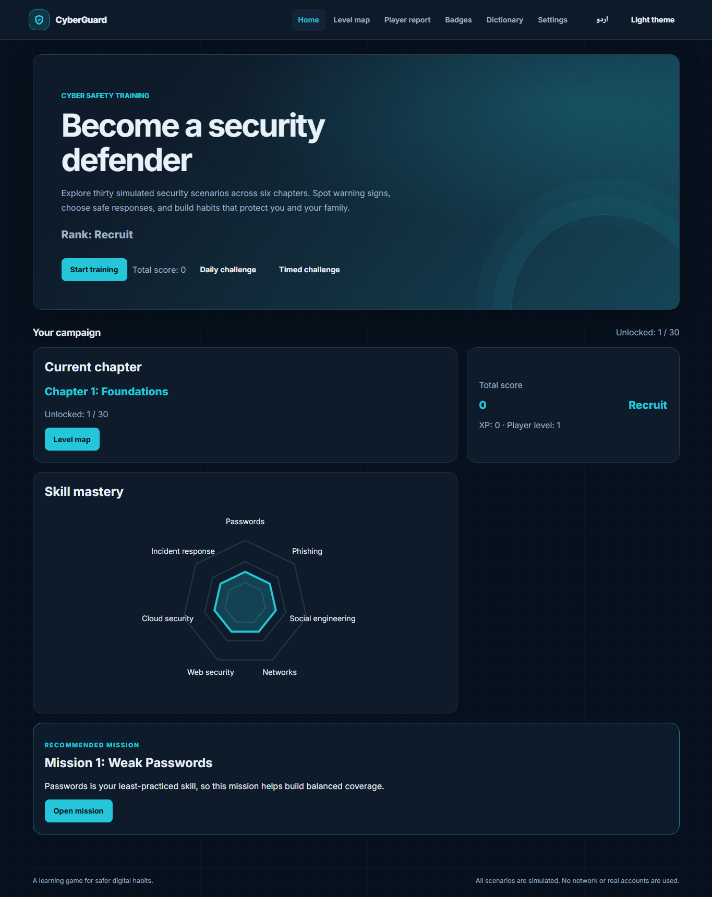
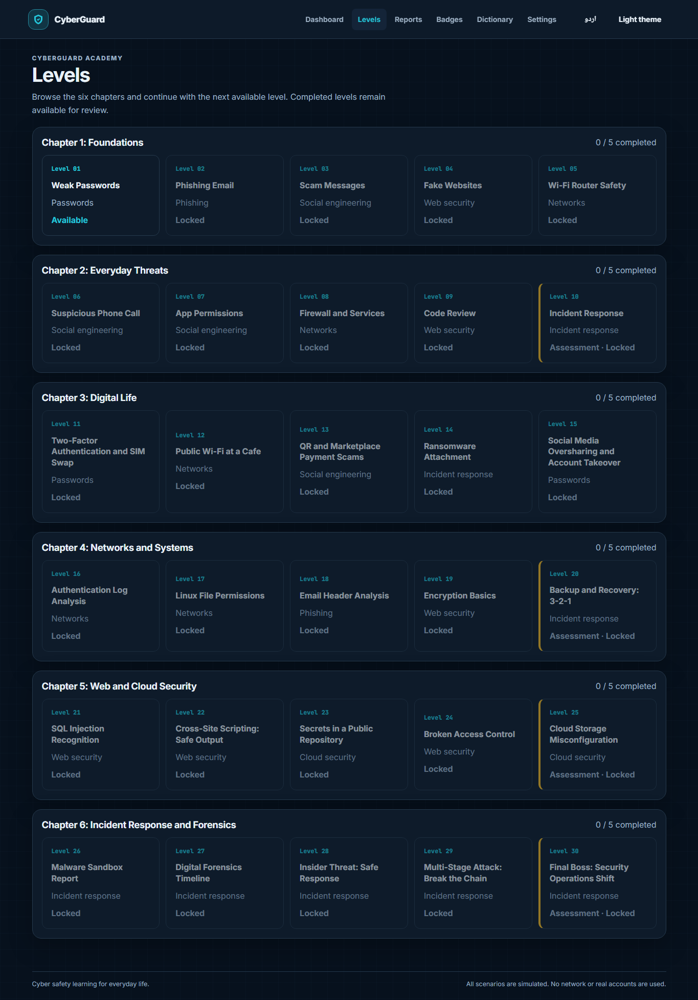
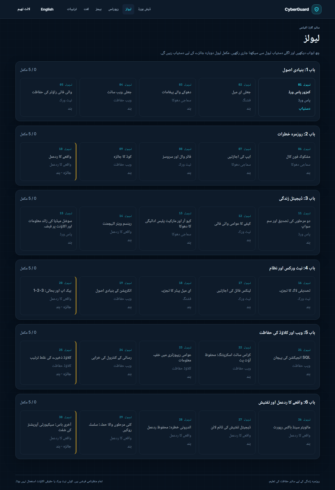
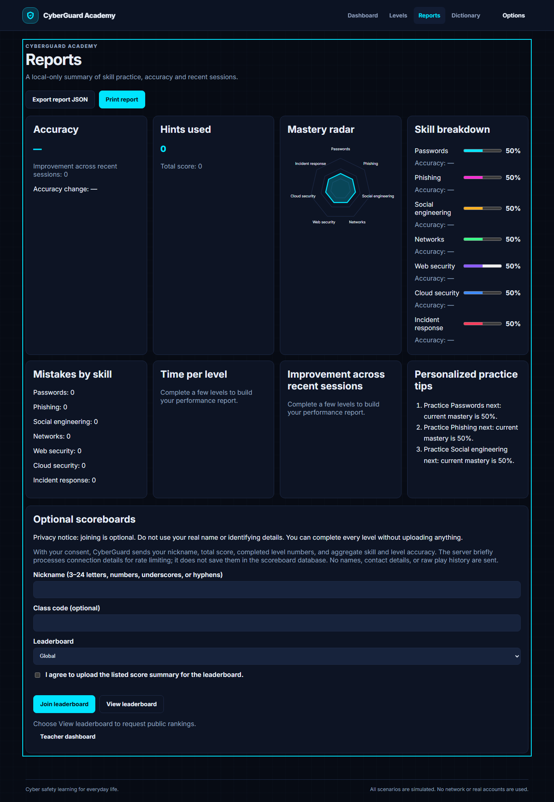
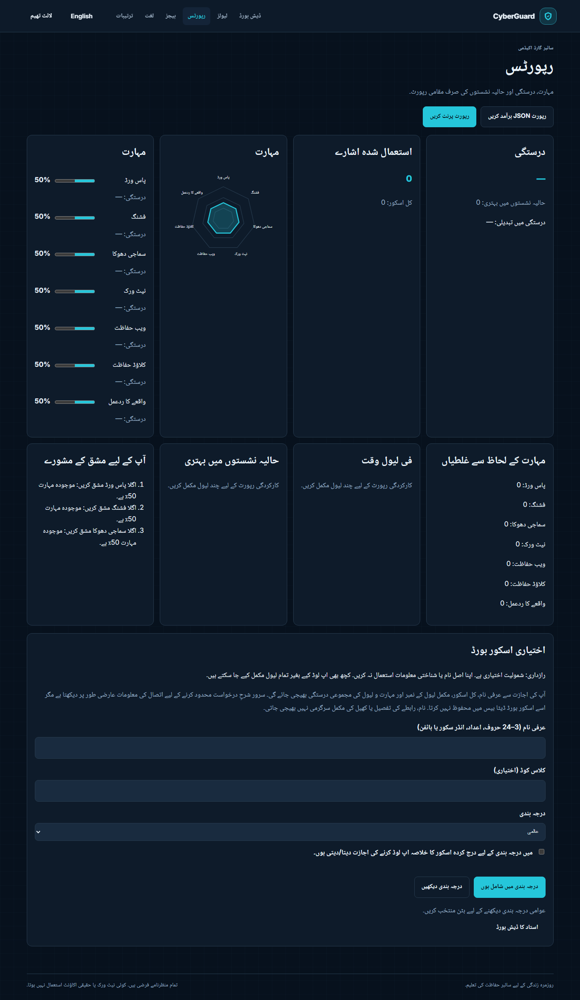

# CyberGuard Academy

CyberGuard Academy is an offline-first, bilingual cyber-safety learning platform for
students and families. It currently provides 30 safe, simulated scenario levels,
local progress and reports, and an optional nickname-only scoreboard. It does not
perform real security tests, access real accounts, or send network traffic during
offline learning.

The Academy transition is staged. The Flask API provides student accounts,
teacher-owned classes and account-linked progress backups. Local progress remains
the gameplay source of truth; signed-in students explicitly choose when to upload,
restore or delete their backup. Structured lessons, formal assessments,
assignments and content administration are not yet implemented.

## Run locally

There is no front-end build step. From the project folder, run:

```powershell
npx serve .
```

Open the localhost address printed by the server. Serving from localhost enables
local JSON loading and the offline service worker. After the first successful load,
the app shell, fonts, translations and level data are cached. Progress and settings
are kept in this browser.

## Optional scoreboard service

The scoreboard is optional. To run the browser app and API together:

```powershell
python -m pip install -r requirements.txt
$env:CYBERGUARD_SECRET_KEY = (python -c "import secrets; print(secrets.token_hex(32))")
$env:CYBERGUARD_TEACHER_INVITE_CODE = (python -c "import secrets; print(secrets.token_urlsafe(24))")
python app.py
```

Open `http://127.0.0.1:5000`. The server binds to localhost by default and stores
scoreboard data in `instance/cyberguard.sqlite3`. Joining requires explicit consent
and a nickname; learners can continue without uploading anything. The service uses
CSRF protection, rate limiting, input validation and score sanity checks. Teacher
reports are available from the Reports screen.

The API also exposes `POST /api/auth/register`, `POST /api/auth/login`,
`GET /api/auth/me`, `POST /api/auth/logout`, and the student-owned
`GET/PUT/DELETE /api/student/progress` backup endpoints. Mutations require the
same-origin CSRF token from `GET /api/csrf` in the `X-CSRF-Token` header.
Registration creates
a student by default; a teacher account requires the server-configured
`CYBERGUARD_TEACHER_INVITE_CODE`, and browser-supplied roles are ignored. Passwords
are stored as scrypt hashes. Teachers can create account-owned classes and view
their class reports after signing in. Students can request to join by class code;
the owning teacher approves or removes memberships. The bilingual Account screen
is available from Options when running through Flask; static-only hosting
continues to support offline learning but cannot use account services. Account
recovery, email verification, admin onboarding and migration of legacy token-owned
classes are not implemented. Legacy token-based class creation remains for
compatibility. Score uploads to account-owned classes require an active student
membership; membership requests only apply to account-owned classes, and legacy
nickname scores remain unverified. Students can explicitly replace or restore a
private account progress backup; it excludes the certificate name and unfinished
attempt, and is never synchronized automatically. Do not use this stage to store
sensitive student records or deploy as a production LMS.

## Learning levels

The 30 levels are organized into six chapters: Foundations, Everyday Threats,
Digital Life, Networks and Systems, Web and Cloud Security, and Incident Response
and Forensics. The Levels screen presents them as an accessible chapter-by-chapter
list. Locked levels remain unavailable until earlier levels are completed; completed
levels can be reviewed. Selecting an available level opens its scenario renderer.

Scenarios use simulated emails, messages, router settings, websites, app permissions,
logs, code and incident reports. Learners identify an issue, select a safe fix, and
review the explanation and practical guidance. English and Urdu, right-to-left
layout, light and dark themes, keyboard controls, self-hosted fonts, responsive
layouts and offline use are supported.

The Levels screen groups missions by chapter and shows each mission's skill,
difficulty rating, estimated duration, issue count, completion stars, and lock
status. Answer choices are shuffled per attempt and remain stable while that
attempt is in progress. Dashboard, Levels, Reports and Dictionary are the primary
destinations; Badges, Settings, language and theme controls are in the Options menu.
The local mastery report labels unattempted and low-sample skills rather than
displaying the engine's neutral starting value as measured performance. A mastery
estimate appears after four answered issues in that skill.

## Responsible use and security

CyberGuard uses fictional, simulated scenarios for learning. Do not use it to scan,
exploit or test real systems, and do not enter real passwords, OTPs, payment
details or other sensitive information. The optional scoreboard is not an
authenticated account or high-stakes assessment service; client-submitted scores
are sanity-checked, not proven. It is not suitable for storing sensitive student
records.

See [SECURITY.md](./SECURITY.md) for private vulnerability reporting and
[THREAT_MODEL.md](./THREAT_MODEL.md) for the current security scope and known
limitations. In production, use HTTPS, a strong persistent secret key, secure
cookies, and a production WSGI server.

## Current project structure

- `index.html`, `css/`, `js/`: application shell, interface, level engine, local
  progress, adaptive recommendations, reporting and scenario renderers.
- `levels/` and `level-catalog.json`: localized 30-level scenario data and index.
- `lang/`: English and Urdu interface, level text, explanations and glossary.
- `app.py`, `js/scoreboard.js`, `js/teacher.js`, `teacher.html`: optional scoreboard
  API, student-account API, browser client and teacher report. SQLite schema
  upgrades are tracked with `PRAGMA user_version` and preserve existing scoreboard
  rows.
- `assets/fonts/`: self-hosted typefaces and their licenses.
- `tests/`, `e2e/`: Node, Python and browser checks.
- `.github/workflows/ci.yml`: automated security scans, lint, formatting and tests.
- `THREAT_MODEL.md`, `SECURITY.md`, `STATUS.md`: security scope, reporting and
  implementation status.
- `service-worker.js`, `manifest.webmanifest`: offline installation support.

See [ARCHITECTURE.md](./ARCHITECTURE.md) for existing components, current navigation,
known limitations and the Academy modules that remain to be implemented.

## Checks

Install JavaScript development dependencies and run the test suites:

```powershell
npm ci
npm run lint
npm run format:check
npm test
npm run test:e2e
```

Run the API tests with:

```powershell
python -m pip install -r requirements-dev.txt
python -m unittest discover -s tests -p "test_app.py"
pip-audit -r requirements.txt
bandit -q -r app.py
```

`npm audit --audit-level=high` checks JavaScript dependencies. GitHub Actions also
runs Gitleaks against repository changes.

## Screenshots











## License

This project is released under the MIT License. See [LICENSE](./LICENSE).
