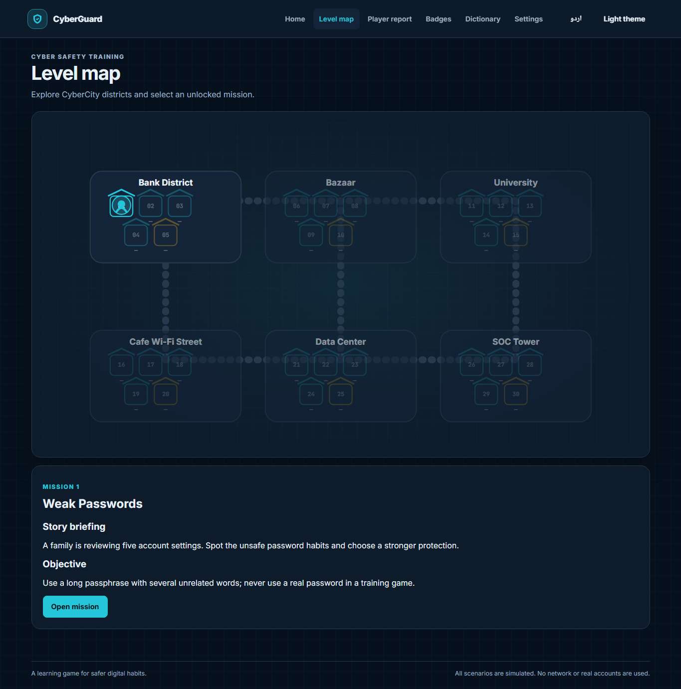
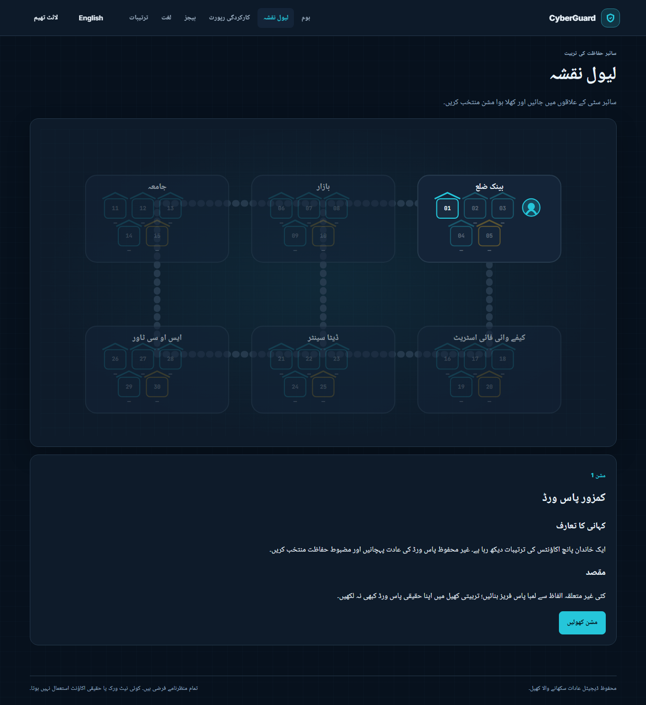

# CyberGuard

CyberGuard is an offline-first, browser-based learning game about everyday cyber safety for students and families. Its 30 simulated missions are presented as an interactive CyberCity map. It uses pretend accounts, messages and systems; campaign play does not require a backend and never performs real security tests.

## Run locally

The game has no build step or runtime dependencies. Serve this folder from localhost so the browser can load local JSON files and enable the offline service worker:

```sh
npx serve .
```

Open the local address printed by the server. After its first successful load, the app shell, fonts, translations and all level data are cached for offline use. Progress, best scores, settings and the certificate name stay in this browser's local storage.

### Optional class scoreboard

The class scoreboard is an opt-in service. To run the game and API together, install Flask and start the local server:

```powershell
python -m pip install -r requirements.txt
$env:CYBERGUARD_SECRET_KEY = (python -c "import secrets; print(secrets.token_hex(32))")
python app.py
```

Open `http://127.0.0.1:5000`. The server binds to localhost by default and stores scoreboard data in `instance/cyberguard.sqlite3`. To keep the game offline-only, use `npx serve .` instead and do not join a scoreboard. A player must read and accept the privacy notice before any score is sent. Only a nickname, score, completed level numbers and aggregate skill/level accuracy are sent; real names, contact details and raw play history are not requested. An accepted player may opt out later in the report screen. Scores queue locally and sync when the same-origin server is available.

Teachers can open **Teacher dashboard** from the report screen to create a class code, view class averages and export a CSV. The private teacher access key is shown once and held only in the current browser session; keep it private. The server stores its hash, applies CSRF protection and per-process rate limiting, validates input and sanity-checks scores against completed levels. Weekly rankings use submissions updated in the last seven days.

## Play

CyberGuard has 30 levels arranged in six chapters:

1. Foundations
2. Everyday Threats
3. Digital Life
4. Networks and Systems
5. Web and Cloud Security
6. Incident Response and Forensics

Move around the CyberCity map with pointer, touch or keyboard arrows; select an unlocked building to view its briefing and objective, then launch its mission. Correct answers resolve issues. Incorrect answers lower the Trust Meter. Hints reduce score; stars, XP, player rank and badges reward progress. Completed levels can be replayed, and daily and timed challenges are available. Level summaries include explanations, real-life tips and learning cards. The Player Report includes a skill radar, accuracy, time, hints, mistakes, recent improvement and personalized tips. It can be printed or exported as JSON.

The game includes English and Urdu, right-to-left layout, light and dark themes, self-hosted fonts, responsive layouts, keyboard-accessible controls and a printable learning certificate. Scenarios are harmless simulations; there are no real credentials, exploit actions, scanning or external runtime requests during offline campaign play.

### Adaptive practice

Adaptive assistance is deterministic and explainable. Each issue records its skill, difficulty, result, hint use and response time. A response signal is 100 for a correct answer without a hint, 70 for a correct answer after using a hint, 0 for an incorrect answer and 55 for a hint. For a correct answer, response time adjusts the signal by at most 10 points in either direction; expected time is `20 + 15 × (difficulty − 1)` seconds.

For difficulty `d` (1–5), mastery updates with an exponential moving average:

`new mastery = round(old mastery + (0.18 + 0.04 × d) × (signal − old mastery))`

Mastery is bounded from 0 to 100. Once there are four scored observations for a skill, mastery below 45 or recent accuracy below 45% adds support (one Trust point, one hint, one distractor and 25% more time). A mission with average issue difficulty 4 or 5 also gets one extra hint, one distractor and 10% more time. Mastery of at least 85 with recent accuracy of at least 80% reduces timed mission time by 15%. The home screen recommends an available mission for the weakest skill and explains the reason. The adaptive logic is isolated in `js/adaptive.js` so a different recommendation strategy can be added without changing gameplay.

## Project structure

- `index.html`, `css/`, `js/`: application shell, visual system, game engine, storage and renderers.
- `teacher.html`, `js/teacher.js`: optional bilingual class dashboard.
- `js/adaptive.js`, `js/scoreboard.js`, `app.py`: local mastery/report logic, opt-in API client and optional Flask/SQLite scoreboard.
- `levels/`: one JSON scenario per level.
- `lang/`: English and Urdu interface and scenario copy, glossary, chapters, ranks and badges.
- `assets/fonts/`: self-hosted typefaces and their licenses.
- `scripts/generate-new-levels.mjs`: generator used for the new bilingual level data.
- `e2e/`: Playwright browser checks for campaign flow and offline persistence.
- `tests/`: Node tests for progression, data, scoring and import/export.
- `.github/workflows/ci.yml`: lint, format and test checks.
- `service-worker.js`, `manifest.webmanifest`: offline PWA support.

## Add a level

1. Add the next `levels/levelNN.json` with an ID, chapter, bilingual title, difficulty, skill tag, scenario type, three to six issues, choices, two plausible wrong fixes per issue, two hints and glossary references. Use `"mode": "ordered"` when steps must be completed in sequence, and set `"timedByDefault": true` only for scenarios that need a timer.
2. Add the matching localized level object at the same array position in both `lang/en.json` and `lang/ur.json`. Include translated item and choice labels, issue explanations, wrong-fix explanations, hints, tips and all four learning-card fields.
3. Add every glossary reference to both locale glossary objects. Update `MAX_LEVELS` and the level index in `js/engine.js` and `js/ui.js`, the precache list in `service-worker.js`, progress import bounds in `js/storage.js`, and tests when extending beyond 30.
4. Run `npm test`, `npm run lint` and `npm run format:check`.
5. To verify optional scoreboard endpoints, run `python -m unittest discover -s tests -p "test_app.py"`.

The shared scenario renderer supports selectable and ordered cards. Use the `log`, `terminal`, `timeline` and `alerts` types for the corresponding monospace or ordered presentations.

## Tests and checks

Install development dependencies and run the project's checks:

```sh
npm ci
npm run lint
npm run format:check
npm test
npm run test:e2e
python -m pip install -r requirements.txt
python -m unittest discover -s tests -p "test_app.py"
```

## Screenshots

The screenshots show the home screen, the interactive city map in both languages and the local performance report.







## License

No license has been selected for this project yet.
